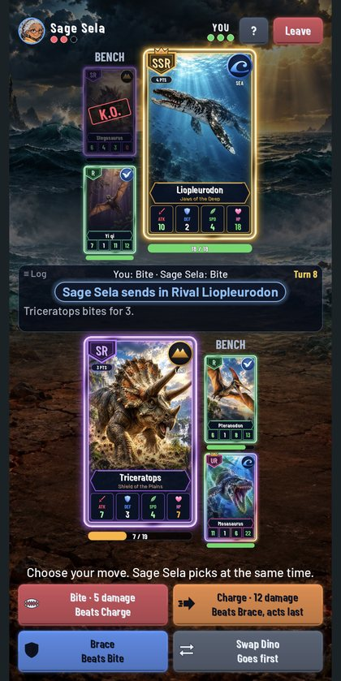
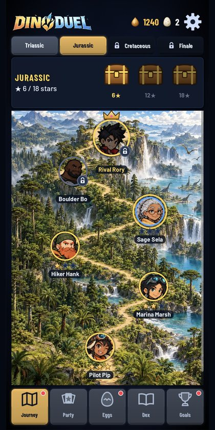
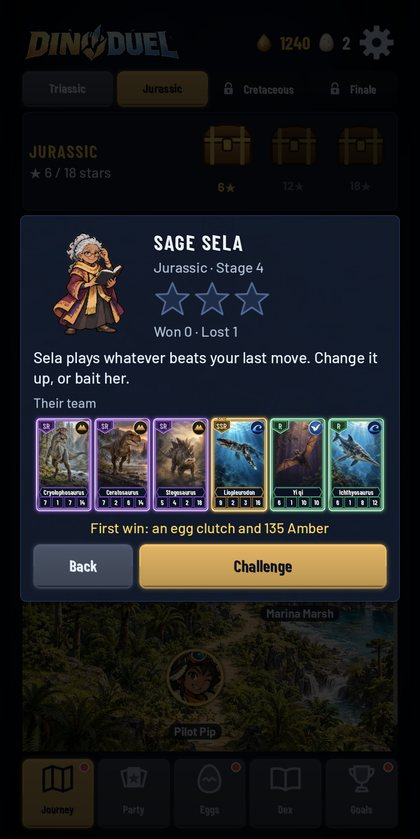
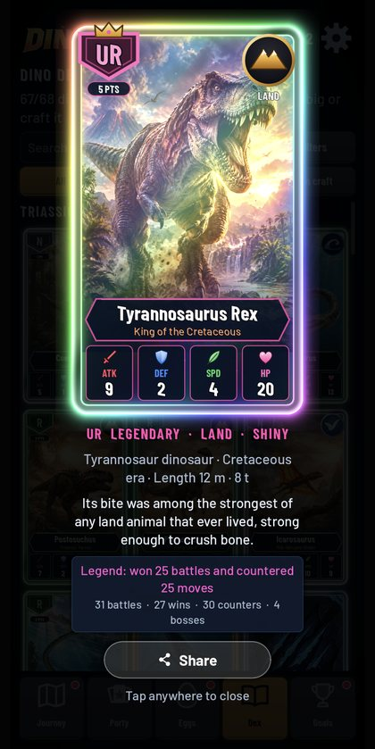
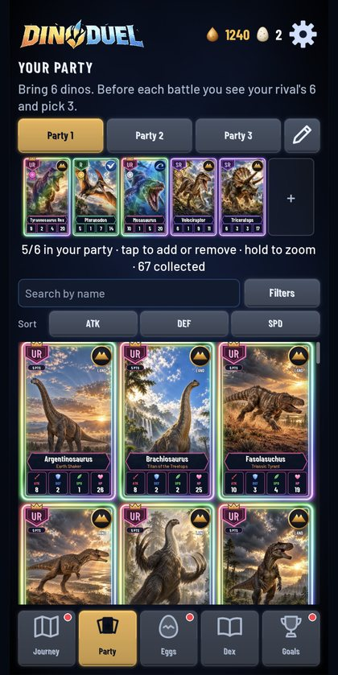
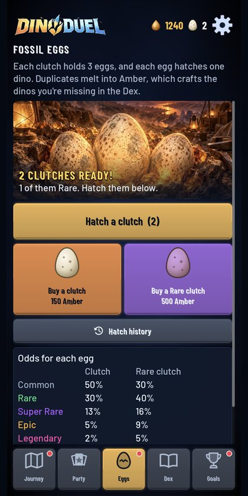
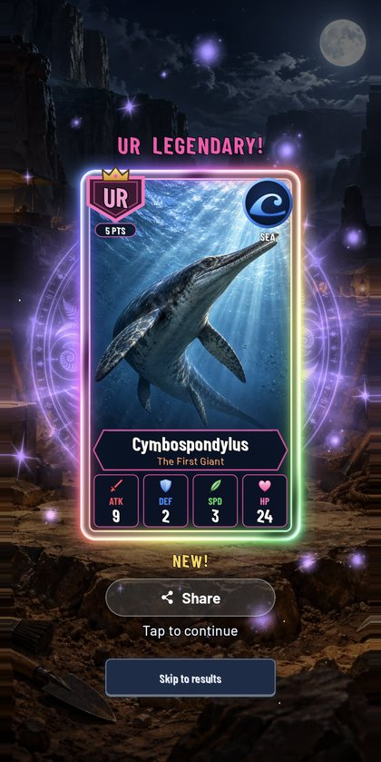
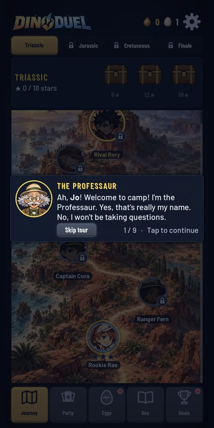
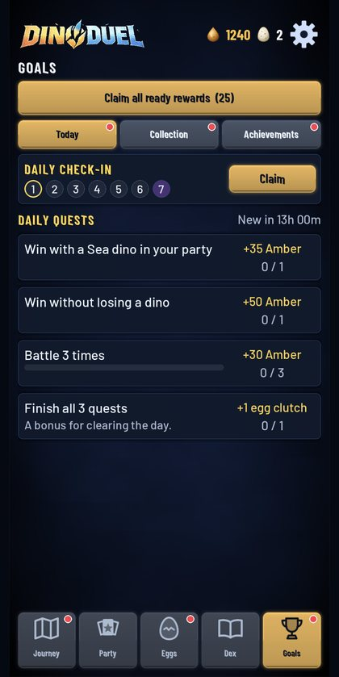

# Dino Duel

A dinosaur card-battle game for Android: hatch fossil eggs, collect 65+ prehistoric creatures, and battle your way from the Triassic to the meteor in quick mind-game duels.

**Website:** https://johanlee2000.github.io/DinoDuel/ · **Privacy policy:** https://johanlee2000.github.io/DinoDuel/privacy-policy.html

  
  
  
  
  
  
  
  
  

## The game

- **A journey through time.** Three illustrated era maps and a finale: 15 rivals, each with a habit to read, and your rival Rory waiting at the end of every era with an Alpha creature. Earn stars for dinos left standing and fill star chests.
- **Mind games, not luck.** Bring six, see your rival's six, pick three. Each turn both sides secretly choose Bite, Charge, Brace or Swap: Bite beats Charge, Charge smashes Brace, Brace blocks Bite, Swap goes first.
- **Land, Sky and Sea.** Land beats Sky, Sky beats Sea, Sea beats Land. Era bonds and balanced parties give bonuses.
- **Collect 68 creatures** in five tiers, N to UR, each a painted card with its real size, era and a fossil fact. Shiny versions, crafting with Amber, sets, a daily check-in, daily quests and 21 achievements.
- **Offline, no ads, no paid random packs.** Progress is saved on the phone.

## Built with

Godot 4.7 (GDScript), for Android, in portrait. The battle and collection rules are plain, UI-free code (`core/`) with their own tests and simulators: an AI-vs-AI balance report and simulated players that tune the Journey's difficulty. See [CLAUDE.md](CLAUDE.md) for the layout and commands, and [docs/GAME_DESIGN.md](docs/GAME_DESIGN.md) for the design.

© 2026 Dino Duel Studios
